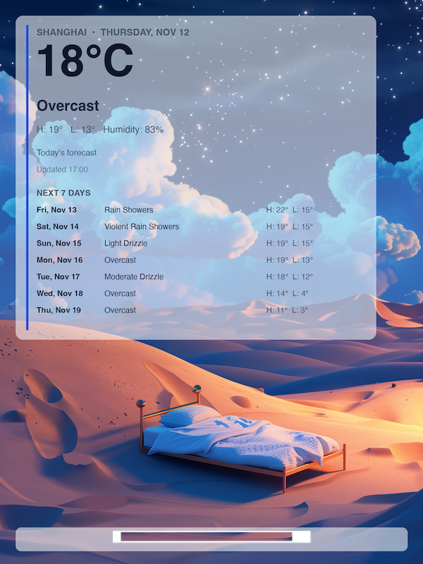
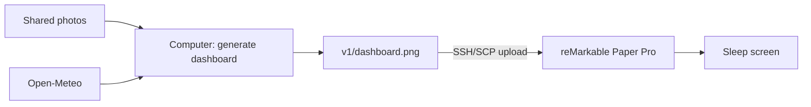
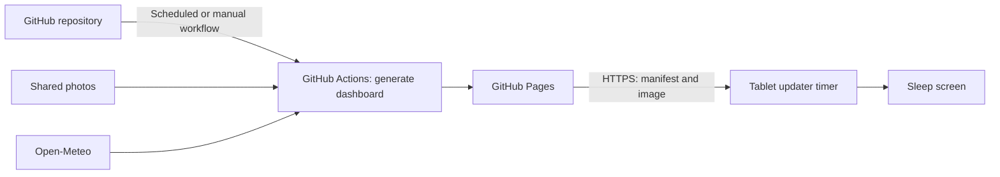

# reMarkable Paper Pro Sleep Screen

## Overview

A weather dashboard for the reMarkable Paper Pro sleep screen allows you to quickly glance at current weather conditions and forecasts without unlocking your tablet. This project provides two approaches to achieve this functionality.

This project provides two ways to generate and deliver a weather dashboard for
the reMarkable Paper Pro sleep screen:

## Version 1 - Local Upload

**[V1](./v1/readme.md)** runs on your computer and uploads the generated
  image directly to the tablet over SSH.

## Version 2 - Download from GitHub Pages

**[V2](./v2/README.md)** generates and publishes images through GitHub Pages;
  a timer on the tablet downloads updates.

## Summary

See each version's README for setup, configuration, and operating details.
