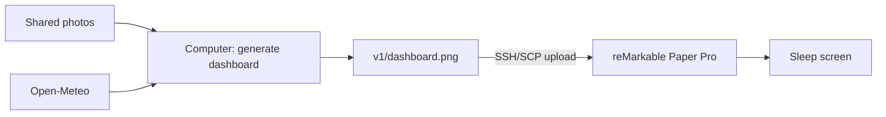
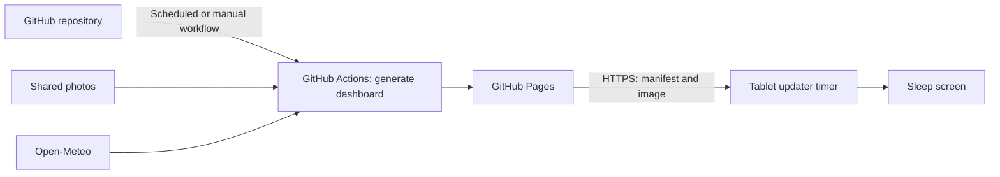

# reMarkable Paper Pro Sleep Screen

## Overview

A weather dashboard for the reMarkable Paper Pro sleep screen allows you to quickly glance at current weather conditions and forecasts without unlocking your tablet.

This project provides two generation/delivery approaches and an optional
on-device application for manual downloading and awake-screen preview:

## Version 1 - Local Upload

**[V1](./v1/readme.md)** runs on your computer and uploads the generated
  image directly to the tablet over SSH.

## Version 2 - Download from GitHub Pages

**[V2](./v2/README.md)** generates and publishes images through GitHub Pages;
  a timer on the tablet downloads updates.

## Version 3 - Oxide Application

**[V3](./v3/README.md)** builds on v2: open Dashboard from Oxide, tap Refresh
to download the latest GitHub Pages image immediately, and preview it while
awake. The same image is used for sleep. V2's GitHub Actions and tablet timer
remain in place; Refresh does not trigger generation.

## Summary

See each version's README for setup, configuration, and operating details.
