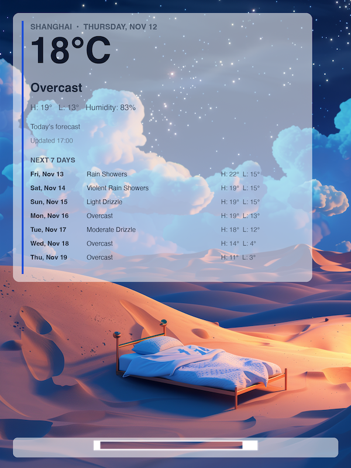
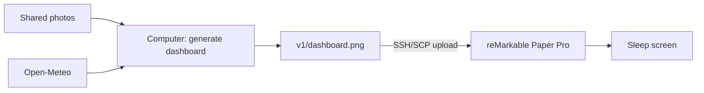
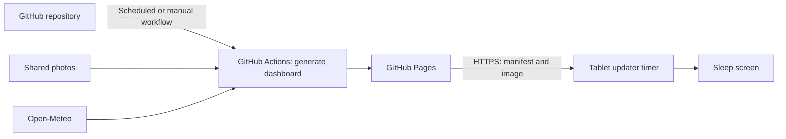

# reMarkable Paper Pro Sleep Screen

## Overview

A weather dashboard for the reMarkable Paper Pro sleep screen allows you to quickly glance at current weather conditions and forecasts without unlocking your tablet.

This project provides two generation/delivery approaches and an optional
on-device application for manual downloading and awake-screen preview:

## Version 1 - Local Upload

**[V1](./v1/readme.md)** runs on your computer and uploads the generated
  image directly to the tablet over SSH.

## Version 2 - Download from GitHub Pages

**[V2](./v2/README.md)** generates and publishes images through GitHub Pages;
  a timer on the tablet downloads updates.

## Version 3 - Manual Refresh Application

**[V3](./v3/README.md)** adds manual refresh and awake-screen preview to v2.
The [AppLoad frontend](./v3/APPLOAD.md) has had initial testing on a Paper Pro;
the separate Oxide frontend remains untested on the device. Refresh downloads
the latest published image, not a newly generated one. The v2 GitHub Actions
and tablet timer remain in place. Review the documented AppLoad crash and
root-filesystem remount risks before use.

## Summary

See each version's README for setup, configuration, and operating details.
