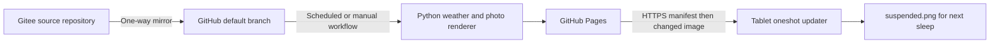

# Sleep Screen v2

V2 generates images on GitHub and lets the tablet pull them. V1's script, tests,
example image and configuration are unchanged. Do not run the v1 uploader while
the v2 timer is enabled: both own the same tablet sleep-screen file.

## Architecture and scope



- The first version checks at boot and every two minutes of running time, using
  a systemd oneshot service and a timer with `WakeSystem=false`. It does not
  intentionally wake the tablet or request Wi-Fi activation.
- This is bounded polling, **not an exact wake or Wi-Fi callback**. Once awake
  and connected, a pending or subsequent check fetches the newest published
  image. Firmware power management may affect timer execution; verify on-device.
  There is no firmware-specific awake-state guard, so this is not a guarantee
  that no work happens during an awake CPU period with the screen asleep.
- Wi-Fi association does not prove Internet access. The HTTPS fetch is the
  connectivity check; offline/captive-portal failures leave the old screen alone.
  Curl requests have a 5-second connection timeout. The manifest has a 20-second
  total timeout; images have a 300-second total timeout to accommodate slow
  connections. Set `IMAGE_TIMEOUT` in `config.env` to 1..1800 seconds if needed.
  Failed checks retry on the next timer interval, without a busy retry loop.
  Longer transfers keep networking active longer, so check battery impact before
  enabling the timer. Downloads remain size-limited and checksum-verified.
- GitHub runs at minute 17 every two hours in UTC. Scheduled Actions can be
  delayed or skipped; this is not a real-time weather service. The next image
  includes current weather, today's high/low, seven additional forecast days,
  a random photo, and an optional contact footer, matching v1's composition.
- Linux uses DejaVu Sans, macOS uses Helvetica if DejaVu is absent. The layout
  is intentionally similar to v1, not pixel-identical across fonts. Dates and
  update time now use the weather location's timezone rather than runner UTC.
- The update replaces an asset, not the current e-ink display. It is intended
  for the **next sleep**. Some firmware caches assets and may need a reboot;
  if every update requires one, unattended operation is not yet feasible on
  that firmware. V2 never reboots or restarts `xochitl` automatically.

## Publication contract

Pages serves only `v2/public`, not the source repository or `.env`:

| Path | Purpose |
| --- | --- |
| `latest.sha256` | One standard checksum line: `SHA256  images/SHA256.png` |
| `images/SHA256.png` | Immutable-addressed, opaque RGB, 1620 x 2160 PNG |
| `latest.json` | Schema version, hash, dimensions, orientation, UTC generation time and local weather time |

The tablet reads the small checksum manifest, compares the installed screen's
hash and downloads only changed images. It rejects unsafe paths, downloads over
20 MiB, wrong checksums and wrong PNG signature/IHDR dimensions or color format.
The cloud fully verifies the generated PNG using Pillow; the shell updater
checks its header and checksum, not a complete PNG decode. HTTPS authenticates
the endpoint; the checksum is integrity checking, not a cryptographic signature.

Download and verification happen on writable home storage. The original screen
is backed up once there. Installation copies into a temporary file beside the
target, then renames atomically. If root was read-only, it is remounted writable
only for installation and restored on normal exit and handled signals. If root
was already writable, its state is preserved. No script can guarantee cleanup
after power loss or `SIGKILL`. A failed read-only remount is explicitly logged.

Pages deployment replaces the published site only after generation succeeds.
A failed forecast/render keeps the previous deployed site. A deployment/cache
race can briefly produce an old manifest pointing to an unavailable image;
the tablet retains its current screen and retries next time.

## GitHub and Gitee setup

1. Keep Gitee as source of truth and mirror **one way** to GitHub. Include the
   workflow, `v2/`, root dependencies/tests and approved photo files. Ensure the
   workflow exists on the GitHub **default branch**. Mirror credentials need
   permission to update workflow files (for example the `workflow` scope for
   a classic GitHub PAT); store those credentials in Gitee's secret settings.
2. Enable GitHub Actions for the repository and allow the Actions used by this
   workflow. Imported/forked workflows may need explicit enabling. In GitHub
   Settings > Pages, select **GitHub Actions** as the publishing source. The
   repository/account must support Pages. Allow the default branch in the
   `github-pages` environment; automatic deploys must not require manual approval.
3. In GitHub Settings > Secrets and variables > Actions, create repository
   variables `LATITUDE`, `LONGITUDE`, `CITY_NAME`. Optionally set
   `DASHBOARD_ORIENTATION` to `portrait` or `landscape` (default: portrait).
   Optionally add the `CONTACT_INFO` secret. V2 reads environment variables;
   it never reads or publishes v1's `.env` and does not require `SSH_HOST`.
4. Ensure the photos you intend to use are actually **tracked and mirrored**.
   V2 deliberately fails if the photo folder is empty, rather than replacing
   a useful dashboard with a plain image. Do not commit private photos to a
   public source repository without considering privacy.
5. Run **Dashboard v2** manually from GitHub's Actions tab. Check the resulting
   Pages URL, then open `/latest.json` and its `image` URL. A `/` homepage is
   not provided; it can return 404 even when those files are available.

No generated image is committed back to GitHub, so output cannot conflict with
Gitee force mirroring. GitHub secrets/variables, Pages settings and environments
do not mirror: configure them on GitHub. Mirror lag still delays code/photo
changes. Public repositories' scheduled workflows can be disabled after 60 days
without repository activity; monitor runs and re-enable as needed. A manual
run is available for recovery. Check current Actions/Pages plan limits.

**Privacy:** This design assumes a publicly readable Pages endpoint. A secret
contact value is still rendered into a public image. Omit sensitive contacts
and photos. A private repository does not automatically mean private Pages.
For private delivery, select an authenticated object store and adapt the
updater's authentication; that is outside this initial implementation. Do not
put a GitHub repository-write token on the tablet.

**Connectivity:** Test access from the tablet's actual network, particularly
if GitHub Pages access is unreliable in your region. Gitee source mirroring
does not improve tablet-to-Pages connectivity. A reachable HTTPS static/object
host implementing the same manifest contract can replace Pages later.

## Tablet installation

Target: **Paper Pro**, with v1's 1620 x 2160 screen dimensions and system asset
path. Other reMarkable models need different dimensions/layout/header checks.
Developer Mode and root SSH access are required; read the official reset and
security warnings and back up documents first. Firmware updates can remove
systemd units or reset assets; keep these installation files off-device. Do not
assume a service can reinstall itself after its registration has been removed.

Keep the tablet awake and connected. On your computer, replace `TABLET_IP`:

```sh
ssh root@TABLET_IP 'mkdir -p /home/root/rpp-sleep-screen-v2'
scp v2/tablet/* root@TABLET_IP:/home/root/rpp-sleep-screen-v2/
ssh root@TABLET_IP
```

On the tablet, first check the available tools:

```sh
for tool in systemctl curl sha256sum dd cmp tr awk flock mktemp mount cp mv rm wc date dirname chmod mkdir; do
    command -v "$tool" || break
done
curl --version
```

Every tool must be available. `curl` must support HTTPS, certificate validation,
`--proto`, `--proto-redir` and `--max-filesize`; the tablet must have a valid
clock and CA certificates. Do not bypass TLS validation. A missing utility
requires firmware-compatible installation before proceeding, not an assumed
package manager. On this Paper Pro, curl was installed through reManager and
HTTPS manifest fetching succeeded. Other devices need their own checks.
The service explicitly includes `/home/root/.vellum/bin` in its PATH so it
can find reManager's curl without loading interactive shell profiles. If curl
works manually but service logs show wget, reinstall the updated service unit
and run `systemctl daemon-reload`; changing the shell PATH alone will not help.
If curl is absent, the updater can use certificate-validating BusyBox `wget`
with OpenSSL and `timeout`; it rejects redirected response chains and warnings
that certificate validation is unimplemented. Its resource limit bounds the
download, followed by an exact size check before parsing or installing it.

Create `/home/root/rpp-sleep-screen-v2/config.env` from `config.env.example`,
set `BASE_URL` to your real HTTPS Pages URL without a trailing slash, then run:

```sh
chmod 600 /home/root/rpp-sleep-screen-v2/config.env
set -a
. /home/root/rpp-sleep-screen-v2/config.env
set +a
CHECK_ONLY=1 sh /home/root/rpp-sleep-screen-v2/update.sh
sh /home/root/rpp-sleep-screen-v2/update.sh
```

Check-only mode verifies a changed image without installing it or remounting
root. The second command actually installs it and backs up the existing screen.
The script reads exported environment variables, not the file itself; always
source it using `set -a` for manual runs. The systemd service loads it directly.
Existing configuration files can omit `IMAGE_TIMEOUT` to use the default 300
seconds. A temporary override for a slower connection is:

```sh
IMAGE_TIMEOUT=600 sh /home/root/rpp-sleep-screen-v2/update.sh
```

Put the tablet to sleep and verify the image. Also verify v1's carousel overlay
workaround if required by your firmware: v2 does not modify carousel assets.
The original v1 command for that workaround also uploads a v1 image, so use it
before enabling the v2 timer, then run the v2 updater again.

Only after the manual test succeeds, install the dedicated units. Run this
block on the tablet; it preserves the initial root mount state:

```sh
(
    set -eu
    restore_ro=0
    trap 'if [ "$restore_ro" = 1 ]; then mount -o remount,ro /; fi' EXIT
    trap 'exit 1' HUP INT TERM
    root_options=$(awk '$2 == "/" {print $4; exit}' /proc/mounts)
    case ",$root_options," in
        *,ro,*) mount -o remount,rw /; restore_ro=1 ;;
        *,rw,*) ;;
        *) echo 'Cannot determine root mount state' >&2; exit 1 ;;
    esac
    cp /home/root/rpp-sleep-screen-v2/dashboard.service /etc/systemd/system/rpp-dashboard-v2.service
    cp /home/root/rpp-sleep-screen-v2/dashboard.timer /etc/systemd/system/rpp-dashboard-v2.timer
    chmod 644 /etc/systemd/system/rpp-dashboard-v2.service /etc/systemd/system/rpp-dashboard-v2.timer
    systemctl daemon-reload
    systemctl enable --now rpp-dashboard-v2.timer
)
systemctl list-timers rpp-dashboard-v2.timer
journalctl -u rpp-dashboard-v2.service -n 30 --no-pager
```

Wake the tablet with Wi-Fi disconnected, then reconnect and allow a few minutes
of awake time. Verify the log and next sleep screen. Check suspend/resume,
reboot persistence and battery impact on your actual firmware before relying
on this service. Immediate wake/network callbacks can be a later, separately
validated enhancement; no unsupported firmware hook is installed here.

## Stop and return to v1

Stop both units first so a running update cannot race with v1:

```sh
systemctl stop rpp-dashboard-v2.timer rpp-dashboard-v2.service
```

To disable it persistently, temporarily remount root writable if it was
read-only, run `systemctl disable rpp-dashboard-v2.timer`, then restore its
original mount state. Use the guarded remount block above, replacing its copy,
reload and enable commands with that disable command. Leave the home backup
in place. V1 can then generate/upload normally without any v2 configuration.

To restore the pre-v2 image instead, while the units are stopped, use that same
guarded remount block with these commands in place of unit installation:

```sh
cp /home/root/rpp-sleep-screen-v2/state/original-suspended.png /usr/share/remarkable/.dashboard-restore.new
chmod 644 /usr/share/remarkable/.dashboard-restore.new
mv -f /usr/share/remarkable/.dashboard-restore.new /usr/share/remarkable/suspended.png
```

The backup is the screen present at the first successful v2 installation,
not necessarily the factory asset. Verify compatibility before restoring a
backup after a firmware upgrade. This does not restore carousel illustrations;
v1's separate restoration command remains available.

## Local generation and validation

Use the root dependencies and your existing virtual environment. Unlike v1,
v2 settings come from the process environment:

```sh
export LATITUDE=31.2304 LONGITUDE=121.4737 CITY_NAME=SHANGHAI
python v2/generate.py
python v2/generate.py --orientation landscape --output-dir v2/public-landscape
python -m unittest discover -s v2/tests -v
python -m unittest discover -s tests -v
sh -n v2/tablet/update.sh
```

Generated output stays under ignored v2 directories. Tests use mock weather
and mocked tablet/network/mount commands; they do not contact or modify a
tablet. GitHub deployment, actual Wi-Fi/wake timing, firmware cache behavior,
battery use and post-upgrade persistence need the manual acceptance checks
above. No firmware access or deployment credentials are required for tests.