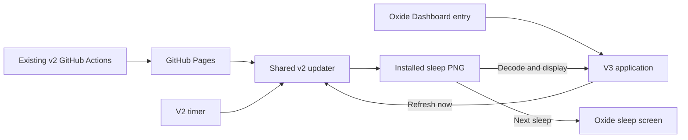

# Dashboard v3 - manual refresh and preview

**AppLoad integration:** For the XOVI/AppLoad frontend, its initial device test
results, known risks, and installation steps, use [APPLOAD.md](./APPLOAD.md).
The instructions below describe the separate, optional Oxide frontend, which
has not been tested on the device; do not install Oxide just to use AppLoad.

The Oxide frontend is a native Qt Quick application for reMarkable Paper Pro,
launched from **Oxide 3.x**. It adds manual downloading and an awake-screen preview to v2.
GitHub Actions still generates the images, GitHub Pages still publishes them,
and the v2 timer stays enabled. No GitHub token or image renderer runs in v3.

## Design and behavior



- Open **Dashboard** to see the installed image immediately.
- **Refresh** runs the existing v2 updater asynchronously, without waiting for
  the timer. It downloads only if the latest published checksum has changed.
- Successful refresh reloads the installed PNG into the preview. An unchanged
  image reports "Already up to date"; it still appears in the preview.
- **Full screen** hides the toolbar; tap the image to bring it back.
- **Back** exits the app, leaving application switching to Oxide.
- The app watches the target directory for atomic replacements and reloads on
  activation. A timer update can therefore refresh the preview too. V3 never
  adds a network polling timer.
- Errors remain visible and are logged to stderr/stdout. A failed refresh or
  invalid PNG retains the previous preview. The app fully decodes the PNG,
  checking dimensions before decoding and limiting the file to 20 MiB.
- During refresh, the buttons and window-close action are disabled so a normal
  exit cannot kill the updater in the middle of filesystem cleanup. Do not
  force-kill the app during installation.

**Refresh downloads; it does not generate.** The image's own "Updated" label
shows its generation time. GitHub schedules and publication can be delayed,
so a successful check does not mean the weather was generated just now.
The app does not fetch `latest.json` separately or treat local download time as
generation time.

## Shared updater and concurrency

Both paths use `/home/root/rpp-sleep-screen-v2/update.sh`, the same `config.env`,
`STATE_DIR`, `TARGET_PATH`, and `update.lock`. Keep the v2 timer enabled.
No duplicate network/download implementation is introduced.

The app sets `REPORT_STATUS=1` and `CHECK_ONLY=0` for its child process:

| Result | Exit status | Protocol line |
| --- | --- | --- |
| Installed | 0 | `RPP_STATUS=updated` |
| Already installed | 0 | `RPP_STATUS=current` |
| Another update holds the lock | 75 | `RPP_STATUS=busy` |
| Validation/network/install/cleanup failure | Nonzero | Diagnostic output |

The app checks **both** exit status and the protocol, so a failed read-only
remount cannot appear successful even if an image was already installed.
Such a failure was observed on a Paper Pro and can leave root writable; see
the [v2 recovery guidance](../v2/README.md#root-remount-failure).
The timer's default busy behavior remains exit 0, now with an explicit log.
If the timer is busy, the app asks you to retry instead of waiting indefinitely
or starting a competing writer.

A newer timer download can replace an earlier manually downloaded image.
That is intentional: GitHub Pages remains the single source of truth.

## Oxide integration and sleep asset

This targets Oxide's native **`oxide` Qt platform plugin**, using Qt Quick's
software renderer. The registration disables legacy preload hooks; the app
does not stop/restart Xochitl, draw directly into a framebuffer, or replace
Oxide's power management.

Oxide's current suspend implementation selects the first decodable image from:

1. `SleepScreenPath` in the `[General]` section of
   `/home/root/.config/remarkable/xochitl.conf`.
2. `/usr/share/remarkable/sleeping.png`.
3. `/usr/share/remarkable/suspended.png`.

Consequently, updating `suspended.png` alone is not sufficient when a
higher-priority image exists. V3 provides an explicit setup command that sets
`SleepScreenPath` to v2's `TARGET_PATH`. It saves only the previous key and its
presence in `sleep-setting-backup.ini` beside the executable, with owner-only
permissions; unrelated Xochitl settings are preserved. Repeating setup does
not replace the original backup.

Use an Oxide release supported by your exact firmware. Upstream support and a
desktop build are not a guarantee of successful on-device rendering, suspend,
lock-screen behavior, or resume. Developer Mode/root access is required; back
up documents before enabling it and follow reMarkable's security/reset warnings.

## Build for Paper Pro

Use a **Linux host or VM** and the official **Paper Pro (`ferrari`) SDK
matching your firmware and host architecture**, not a reMarkable 2 toolchain.
The official download list provides both x86_64 and aarch64 Linux host SDKs
from firmware 3.27.0.97 onward. An ARM64 Linux VM on Apple Silicon can therefore
use the aarch64 host SDK; the installer does not run directly on macOS.
Install CMake and the
SDK prerequisites described by reMarkable. Activate the SDK in the same shell
as the build:

For firmware **3.29.1.0**, OS **6.0.112 (wrynose)**, select one of these
[official SDKs](https://developer.remarkable.com/links):

- ARM64 Linux host: `remarkable-production-image-6.0.112-ferrari-public-aarch64-toolchain.sh`
- x86_64 Linux host: `remarkable-production-image-6.0.112-ferrari-public-x86_64-toolchain.sh`

Use the environment setup script supplied by that SDK installation. The
activation path below is an example; confirm the installed filename.

```sh
source /path/to/sdk/environment-setup-cortexa53-crypto-remarkable-linux
cmake -S v3 -B v3/build-tablet \
  -DCMAKE_TOOLCHAIN_FILE="$OECORE_NATIVE_SYSROOT/usr/share/cmake/OEToolchainConfig.cmake" \
  -DCMAKE_BUILD_TYPE=Release
cmake --build v3/build-tablet --parallel 2
cmake --install v3/build-tablet --prefix "$PWD/v3/build-tablet/package"
file v3/build-tablet/package/rpp-dashboard
```

The executable must be Linux **aarch64**. A desktop macOS/Linux build is for
testing only and must not be copied to the tablet. Target builds require Qt6
Core/Gui/Quick; no Qt Widgets, Qt Quick Controls, or liboxide development
dependency is used. Runtime requires Oxide's platform plugin and compatible
Qt6/QML libraries on the tablet. Keep desktop tests off in the tablet build.

## Install alongside v2

First complete v2's manual download/sleep test and install a compatible Oxide
release. Keep your existing v2 configuration and GitHub workflow.

On the computer, replace `TABLET_IP`. Copy the updated shared script under a
temporary name rather than replacing a running shell script in place:

```sh
ssh root@TABLET_IP 'mkdir -p /home/root/rpp-dashboard-v3 /home/root/.local/share/applications'
scp v2/tablet/update.sh root@TABLET_IP:/home/root/rpp-sleep-screen-v2/update.sh.new
scp v3/build-tablet/package/rpp-dashboard v3/tablet/launch.sh \
  root@TABLET_IP:/home/root/rpp-dashboard-v3/
scp v3/tablet/dashboard.oxide \
  root@TABLET_IP:/home/root/.local/share/applications/rpp-dashboard.oxide
ssh root@TABLET_IP
```

On the tablet:

```sh
chmod 755 /home/root/rpp-dashboard-v3/launch.sh /home/root/rpp-dashboard-v3/rpp-dashboard
chmod 600 /home/root/rpp-sleep-screen-v2/update.sh.new
mv /home/root/rpp-sleep-screen-v2/update.sh.new /home/root/rpp-sleep-screen-v2/update.sh
chmod 644 /home/root/.local/share/applications/rpp-dashboard.oxide
/home/root/rpp-dashboard-v3/launch.sh --configure-sleep-screen
```

Setup reads the same v2 configuration as Refresh. Keep values compatible with
both shell assignments and systemd `EnvironmentFile` syntax. Custom
`STATE_DIR` and `TARGET_PATH` must be absolute and identical for the service
and app. Do not add a separate v3 URL or state directory.

After saving your work, restart Oxide using your normal procedure, or reboot
manually. This loads the registration and sleep setting. **Dashboard** should
appear in its launcher. No automatic reboot or system-service restart is
performed by this project.

The launcher wrapper checks missing configuration/updater files and adds
Vellum's tools to `PATH`, matching the v2 service. A launch failure appears in
Oxide logs; an updater failure appears in the app. Diagnose missing runtime
plugins/libraries using the launch output and `journalctl -u tarnish --no-pager`
if your Oxide installation uses that service name.

## On-device acceptance checks

1. Open Dashboard: the existing installed image appears without sleeping.
2. Refresh with no new publication: "Already up to date" appears.
3. Publish a new image using the existing **Dashboard v2** workflow. Refresh:
   the new PNG appears immediately; its bytes/hash match `TARGET_PATH`.
4. Press the power button: Oxide shows that same image, without a reboot.
5. Wake and use Back: normal Oxide/document use remains functional.
6. Let the v2 timer update while the app is open: the preview reloads, and the
   next sleep uses the newly installed image.
7. Refresh during a timer transfer: a busy message appears, with no competing
   installation; retry after the timer finishes.
8. Disconnect Wi-Fi and Refresh: the app reports the error and retains the
   installed image. Restore connectivity and retry.
9. Test sleep during download, resume, passcode locking, full-screen controls,
   reboot persistence, and battery impact on your actual device. V3 does not
   inhibit suspend or enable Wi-Fi; scheduling/transfer continuation depends
   on Oxide and firmware.

The updater's existing power-loss/`SIGKILL` limitations remain. Firmware
upgrades may reset assets, registrations, services, or plugins; keep build and
installation files off-device and repeat acceptance checks after upgrades.
Hardware acceptance is required before calling this production-ready.

## Restore/remove v3

Exit Dashboard and ensure no manual refresh is running. On the tablet:

```sh
/home/root/rpp-dashboard-v3/launch.sh --restore-sleep-screen
rm /home/root/.local/share/applications/rpp-dashboard.oxide
```

Restart Oxide normally afterward. This restores only the previous sleep-path
setting, not an earlier PNG. The v2 timer and updater remain installed and
enabled. Keep the backup until restoration has been verified. To restore the
old image itself, follow v2's separate restoration instructions.

## Desktop validation

Install Qt6 development libraries and QtQuick/QtQuick.Window QML runtime
modules. Point CMake at your Qt6 installation if it is not on the default
search path:

```sh
cmake -S v3 -B v3/build -DBUILD_TESTING=ON
cmake --build v3/build --parallel 2
ctest --test-dir v3/build --output-on-failure
python -m unittest discover -s v2/tests -p test_tablet.py -v
python -m unittest discover -s v3/tests -p 'test_*.py' -v
sh -n v2/tablet/update.sh
sh -n v3/tablet/launch.sh
```

Use v1's Python requirements for the updater fixtures. Native tests exercise
image decoding, replacements, process results, concurrency guarding, QML
loading, and sleep-setting backup/restore. Shell tests mock the tablet/network
tools; they never remount a real filesystem or contact a tablet.
The separate v3 CI workflow validates these paths without changing the v2
generation/deployment workflow.

For a safe desktop preview, use the existing v1 sample and a nonexistent
updater path so Refresh cannot modify your computer:

```sh
TARGET_PATH="$PWD/v1/dashboard.png" UPDATER_PATH=/nonexistent/update.sh \
  QT_QUICK_BACKEND=software ./v3/build/rpp-dashboard
```

### Interface references

- [Official Paper Pro SDK](https://developer.remarkable.com/documentation/sdk)
- [Official Qt Quick guidance](https://developer.remarkable.com/documentation/qt_epaper)
- [Oxide registration specification](https://github.com/Eeems-Org/oxide/blob/master/web/src/documentation/03_application_registration_format.rst)
- [Oxide suspend implementation](https://github.com/Eeems-Org/oxide/blob/master/applications/system-service/systemapi.cpp)
- [Oxide sleep-path setting](https://github.com/Eeems-Org/oxide/blob/master/shared/liboxide/xochitlsettings.h)
